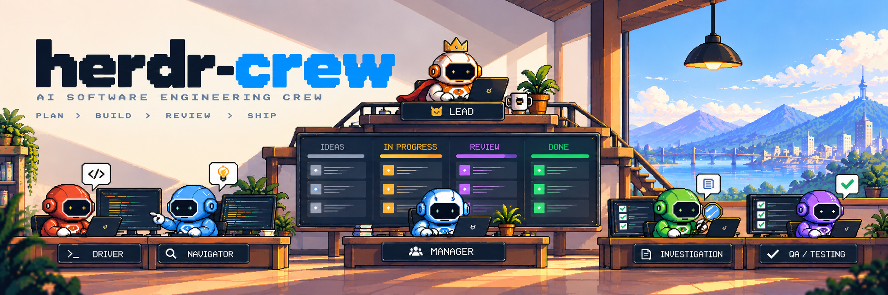

# herdr-crew



**herdr-crew is a Claude Code skill that launches a multi-agent development crew inside Herdr.** One command starts a Lead agent that talks to you, a Manager agent that opens worker teams, and a shared task board (tsk). Development teams work in isolated Git worktrees, write code test-first, review their own work, and leave a branch for you to merge. The investigation team reads the current repository without a new branch or worktree.

This is the Claude Code skill and launcher, not the Rust `herdr` plugin that shares the name. See [how the two projects differ](docs/comparison.md).

**Experimental:** automated launcher checks pass, but full live development acceptance is pending. See [known limitations](#known-limitations) and [verification status](docs/STATE.md).

## What you get

- A **Lead** that plans work, may ask you questions, and owns the board; a **Manager** that starts teams and watches workers.
- Job agents for implementation, testing, review, bug triage and investigation, plus stackable domain personas for NestJS, React, UI and security work.
- A shared **tsk** task board with the states `open -> ready -> started -> review -> done`.
- Isolated Git worktrees for each development team; the investigation team reads the current repository.
- Human approval before any push, merge or worktree removal.

## How it works

A crew lives in one app tab. The Lead and the Manager sit at the top, and the board sits under the Lead:

```
+------------------------+------------------------+
|  Lead                  |  Manager               |
|  talks to you          |  starts worker teams   |
+------------------------+                        |
|  Board (tsk)           |                        |
+------------------------+------------------------+
```

The Lead splits your job into tasks, such as T1 and T2. The Manager starts a team for each task in its own tab. A development team tab such as "T7 pair" uses a worktree at `~/.herdr/worktrees/<slug>/T7-pair`. An "investigate" tab uses the current repository. The `<slug>` is a short id for your repository:

```
+------------------------+------------------------+
|  driver (member)       |  navigator (inspector) |
|  writes code and tests |  reviews, runs tests   |
+------------------------+------------------------+
   worktree: ~/.herdr/worktrees/<slug>/T7-pair
```

Each task moves through these states on the board:

```
open -> ready -> started -> review -> done
```

The Lead marks tasks `ready`. Agents mark them `started` and `review`. For development, the Manager marks `done` after code-review approval; you still merge the branch. For investigation, the Manager checks answer coverage and marks `done` without a merge branch. A task is `blocked` when information prevents progress, or when development review is not approved after three rounds. Standalone jobs without a Manager leave results at `review` for manual acceptance.

Agents talk with `herdr-crew say <agent> "<message>"` and report with `herdr-crew mark <T#> <status> "<note>"`. The mark command updates the board, adds the note as a step, and renames the saved tab to `<label> · <agent>: <note>`.

## Requirements

- **herdr-app**, the desktop app, and **herdr-core** (`hc`) on your PATH. The app owns spaces, tabs and panes. `hc` owns send, read, wait, status and kill. Crew control actions address saved terminal IDs. Install both from <https://herdr.dev/download>; the app installer also installs `herdr-core` when it is missing. Supported desktops are Apple Silicon macOS, Linux x86-64 or ARM64 with Vulkan, and Windows x64.
- **A desktop session.** `launch`, `team`, `say`, `mark`, `status`, `watch`, `close` and `restart` need a running app window that answers `herdr-app status`. A server, container or CI runner without a desktop session cannot run them. `help`, `--version`, `completion`, `init`, `upgrade` and `configure` still work without the app.
- **Claude Code** (the default), or **OpenCode 2** for roles assigned to it. Mixed-agent teams need both selected CLIs on PATH. Authenticate each CLI separately before launching a crew.
- **tsk**, the task board. Install it with `brew install smarzban/tap/tsk`, then run `tsk setup claude` once to register tsk with Claude Code. The board is a plain `tsk` terminal in the crew tab. `tsk setup herdr` and `herdr server reload-config` no longer apply.
- **jq**, **git**, **rg** (ripgrep), and **shasum**. The launcher uses rg for visible-paste detection and shasum for the repository slug.
- **npm**, only if you want `install-skills` to install the AXI tools.
- Bash and a `readlink` command supporting `-f` (the launcher resolves symlinks with it).

## Quick start

1. Install **herdr-app** and **herdr-core** from <https://herdr.dev/download>, then confirm `hc --version` and `herdr-app --version`.
2. Clone this repository and link the launcher and skill into place:

```bash
project_dir="$(pwd -P)"
mkdir -p "$HOME/.local/bin" "$HOME/.claude/skills"
ln -s "$project_dir/bin/crew" "$HOME/.local/bin/herdr-crew"
ln -s "$project_dir" "$HOME/.claude/skills/herdr-crew"
```

3. Check and install the persona skills:

```bash
~/.claude/skills/herdr-crew/bin/install-skills --check
~/.claude/skills/herdr-crew/bin/install-skills
```

4. Open a terminal in Herdr, change into your repository, and start a crew:

```
/herdr-crew lead "Add a CSV export button to the reports page"
```

The tab opens in the background: switch to it yourself. The Lead proposes tasks, the Manager opens a tab per task, and you watch progress on the board, in the team tab titles, and with `herdr-crew status`.

The [quick start guide](docs/quickstart.md) covers every step, including the manual `caveman:caveman` prerequisite and what a normal session looks like.

## Documentation

| Page | What it covers |
|---|---|
| [Quick start](docs/quickstart.md) | Install the runtime, install herdr-crew, start your first crew |
| [Usage](docs/usage.md) | Start one team, pick personas, status, watch, close, plan, handoffs, merge |
| [Configuration](docs/configuration.md) | Project agents, runtime assignments, upgrades, custom teams |
| [Reference](docs/reference.md) | Profiles, personas, teams, commands, output, environment variables, AXI tools |
| [Claude Code support](docs/claude-support.md) | Default runtime, hooks, Monitor, Explore, context budget |
| [OpenCode 2 support](docs/opencode-support.md) | Model selection, permissions, skills and limits |
| [Troubleshooting](docs/troubleshooting.md) | Known limitations and failure modes |
| [FAQ](docs/faq.md) | Short answers before installing |
| [Comparison](docs/comparison.md) | This project vs the Rust Herdr plugin of the same name |
| [Feature reference](docs/features.md) | Every option, flow and hook detail |

## Frequently asked questions

**Do I need Herdr?** Yes. The app owns spaces, tabs and panes, and `hc` controls the terminals. Headless servers, containers and CI runners are unsupported.

**Is this the same as the other GitHub project called herdr-crew?** No. This is a Claude Code skill and Bash launcher. The other well-known repository is a Rust Herdr plugin configured by `.herdr/crew.toml`. See the [comparison](docs/comparison.md).

**Does herdr-crew push or merge my changes?** No. Merging is your decision, crew instructions require approval, and member sessions have explicit Bash denies for `git push` and `git merge`.

**Can I run OpenCode instead of Claude Code?** Yes, OpenCode 2 is supported per role. Codex, Gemini and other agent kinds need permission and lifecycle adapters. See [OpenCode 2 support](docs/opencode-support.md).

The [FAQ](docs/faq.md) answers more questions about worktrees, state, context limits and Windows.

## Known limitations

- The runtime needs a desktop session. `launch`, `team`, `close` and the other runtime commands do not work on a headless server, container or CI runner.
- Restart reuses the terminal only after a normal agent exit. After `hc kill`, or when the terminal reports `finished`, relaunch the team.
- Worktrees are never removed automatically. Run the removal command that `close` prints.
- Unverified on this runtime: an app restart with live terminals, pane title behavior, the split ratio, headless use, and a real permission-blocked agent. No live crew has run since the migration.
- Visual planning has automated launch/instruction checks and a browser-checked example. Live Lead/planner approval, revision, offline fallback and restart acceptance remain pending.

The [troubleshooting guide](docs/troubleshooting.md) covers every limitation, including message delivery, tab titles, `tsk` step rules, custom project jobs and skills with `UNKNOWN` sources.

## Testing

From the skill directory, run:

```bash
/bin/bash test/dry-run.sh
/bin/bash test/worktrees.sh
/bin/bash test/agent-config.sh
```

The test puts fake `hc`, `herdr-app`, `tsk`, and `git` commands first on your PATH, and checks the calls they record. No real agents start and no real tasks are made. Each check prints `PASS` or `FAIL`, and the run ends with `ALL PASS` or a failure count.

`test/worktrees.sh` uses real Git with fake core/app and tsk commands and a disposable HOME. It checks branch attachment, retained edits, reuse, and ownership refusals. Neither suite establishes live agent behavior. [STATE.md](docs/STATE.md) separates automated checks from live acceptance and remaining gaps.

## File layout

```
herdr-crew/
├── README.md            this file
├── SKILL.md             the /herdr-crew command and its instructions
├── bin/
│   ├── crew             the launcher (installed as herdr-crew)
│   ├── ctx-guard        context budget hook (warns at 135K tokens, once per session)
│   └── install-skills   checks for and installs persona skills
├── agents/              profiles and bundled job instructions with JSON metadata
├── hooks/               project-copyable lifecycle hook scripts
├── personas/            stackable domain guidance
├── teams/               team layouts (.conf files)
├── skills.sources       where each skill comes from, or UNKNOWN
├── docs/                user guides, feature reference, verification state, ADRs and research
└── test/
    ├── dry-run.sh       hermetic launcher checks
    └── worktrees.sh     real-Git regression checks
```

## Docs

The `docs/` folder has two kinds of material. Start with the user guides above, or browse the [docs index](docs/README.md). The internal records are [STATE.md](docs/STATE.md), [PROGRESS.md](docs/PROGRESS.md), and the [ADRs](docs/adr/).

## License

[MIT](LICENSE).
