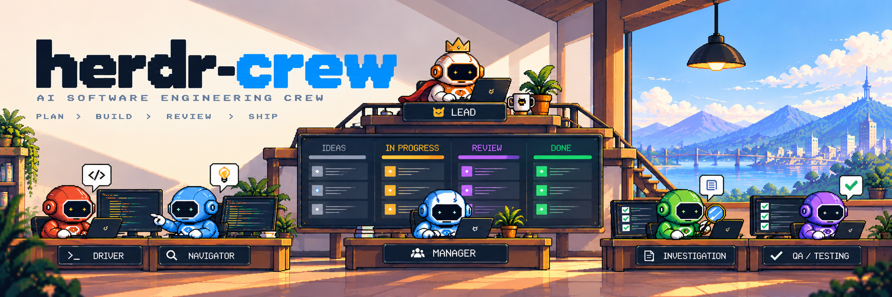

# herdr-crew



**herdr-crew = deterministic multi-agent orchestration framework for coding agents, shipped as Claude Code skill and Bash launcher. Runs agent crews inside Herdr, optional roles on OpenCode 2 and Command Code.** One command starts Lead agent (talks to you), Manager agent (opens worker teams), shared task board (tsk) — declarative agent definitions, native permission enforcement, git worktree isolation per team, and a fixed `ready -> started -> review -> done` workflow with review gates. Dev teams write code test-first, self-review, leave branch for you to merge. Investigation team reads current repo, no new branch or worktree.

Skill and launcher, not Rust `herdr` plugin with same name. See [how the two projects differ](docs/comparison.md).

**Experimental:** automated launcher checks pass; full live dev acceptance pending. See [known limitations](#known-limitations) and [verification status](docs/STATE.md).

## What you get

- **Lead** plans work, may ask questions, owns board; **Manager** starts teams, watches workers.
- Job agents for implementation, testing, review, bug triage, investigation, plus stackable domain personas for NestJS, React, UI, security.
- Shared **tsk** board, states `open -> ready -> started -> review -> done`.
- Isolated Git worktree per dev team; investigation team reads current repo.
- Human approval before any push, merge or worktree removal.

## How it works

Crew lives in one app tab. Lead and Manager on top, board under Lead:

```
+------------------------+------------------------+
|  Lead                  |  Manager               |
|  talks to you          |  starts worker teams   |
+------------------------+                        |
|  Board (tsk)           |                        |
+------------------------+------------------------+
```

Lead splits job into tasks (T1, T2). Manager starts team per task in own tab. Dev team tab like "T7 pair" uses worktree at `~/.herdr/worktrees/<slug>/T7-pair`. "investigate" tab uses current repo. `<slug>` = short repo id:

```
+------------------------+------------------------+
|  driver (member)       |  navigator (inspector) |
|  writes code and tests |  reviews, runs tests   |
+------------------------+------------------------+
   worktree: ~/.herdr/worktrees/<slug>/T7-pair
```

Each task moves through these board states:

```
open -> ready -> started -> review -> done
```

Lead marks tasks `ready`. Agents mark `started` and `review`. Dev: Manager marks `done` after code-review approval; you still merge branch. Investigation: Manager checks answer coverage, marks `done`, no merge branch. Task `blocked` when missing info prevents progress, or dev review not approved after three rounds. Standalone jobs without Manager leave results at `review` for manual acceptance.

Agents talk via `herdr-crew say <agent> "<message>"`, report via `herdr-crew mark <T#> <status> "<note>"`. Mark updates board, adds note as step, renames saved tab to `<label> · <agent>: <note>`.

## Requirements

- **herdr-app** (desktop app) and **herdr-core** (`hc`) on PATH. App owns spaces, tabs, panes. `hc` owns send, read, wait, status, kill. Crew control actions address saved terminal IDs. Install both from <https://herdr.dev/download>; app installer also installs `herdr-core` if missing. Supported desktops: Apple Silicon macOS, Linux x86-64 or ARM64 with Vulkan, Windows x64.
- **Desktop session.** `launch`, `team`, `say`, `mark`, `status`, `watch`, `close`, `restart` need running app window answering `herdr-app status`. Server, container, CI runner without desktop session cannot run them. `help`, `--version`, `completion`, `init`, `upgrade`, `configure` still work without app.
- **CLI for every assigned role**: **Claude Code** (default), **OpenCode 2**, or **Command Code** (`cmd`, 1.88.5+). Mixed-agent teams need each selected CLI on PATH. Authenticate each CLI separately before launch; launcher does not check credentials or model access.
- **tsk** task board. Install with `brew install smarzban/tap/tsk`, then run `tsk setup claude` once to register with Claude Code. Board = plain `tsk` terminal in crew tab. `tsk setup herdr` and `herdr server reload-config` no longer apply.
- **jq**, **git**, **rg** (ripgrep), **shasum**. Launcher uses rg for visible-paste detection, shasum for repo slug.
- **npm**, only if you want `install-skills` to install AXI tools.
- Bash and `readlink` supporting `-f` (launcher resolves symlinks with it).

Run `herdr-crew doctor` to check list in one pass. Reports every missing requirement with fix, works before runtime tools installed, changes nothing. Credentials and model access not checked.

## Quick start

1. Install **herdr-app** and **herdr-core** from <https://herdr.dev/download>, then confirm `hc --version` and `herdr-app --version`.
2. Clone repo, link launcher and skill into place:

```bash
project_dir="$(pwd -P)"
mkdir -p "$HOME/.local/bin" "$HOME/.claude/skills"
ln -s "$project_dir/bin/crew" "$HOME/.local/bin/herdr-crew"
ln -s "$project_dir" "$HOME/.claude/skills/herdr-crew"
```

3. Check and install persona skills:

```bash
~/.claude/skills/herdr-crew/bin/install-skills --check
~/.claude/skills/herdr-crew/bin/install-skills
```

4. Check machine can launch crew:

```bash
herdr-crew doctor
```

Reports every missing requirement in one pass with fix, exits 0 when ready. Warnings (e.g. uninitialized project baseline) don't block launch.

5. Open terminal in Herdr, cd into repo, start crew:

```
/herdr-crew lead "Add a CSV export button to the reports page"
```

Tab opens in background: switch to it yourself. Lead proposes tasks, Manager opens tab per task; watch progress on board, team tab titles, and `herdr-crew status`.

[Quick start guide](docs/quickstart.md) covers every step, incl. skill install and normal session. If launch fails, run `herdr-crew doctor` and act on fixes; [troubleshooting guide](docs/troubleshooting.md) covers failures it can't fix.

## Documentation

| Page | What it covers |
|---|---|
| [Quick start](docs/quickstart.md) | Install the runtime, install herdr-crew, start your first crew |
| [Usage](docs/usage.md) | Start one team, pick personas, status, watch, close, plan, handoffs, merge |
| [Configuration](docs/configuration.md) | Project agents, runtime assignments, upgrades, custom teams |
| [Reference](docs/reference.md) | Profiles, personas, teams, commands, output, environment variables, AXI tools |
| [Claude Code support](docs/claude-support.md) | Default runtime, hooks, Monitor, Explore, context budget |
| [OpenCode 2 support](docs/opencode-support.md) | Model selection, permissions, skills and limits |
| [Command Code support](docs/command-code-support.md) | Session mod, models, permissions and context warning |
| [Troubleshooting](docs/troubleshooting.md) | Known limitations and failure modes |
| [FAQ](docs/faq.md) | Short answers before installing |
| [Comparison](docs/comparison.md) | This project vs the Rust Herdr plugin of the same name |
| [Feature reference](docs/features.md) | Every option, flow and hook detail |

## Frequently asked questions

**Do I need Herdr?** Yes. App owns spaces, tabs, panes; `hc` controls terminals. Headless servers, containers, CI runners unsupported.

**Is this the same as the other GitHub project called herdr-crew?** No. This = Claude Code skill + Bash launcher. Other well-known repo = Rust Herdr plugin configured by `.herdr/crew.toml`. See [comparison](docs/comparison.md).

**Does herdr-crew push or merge my changes?** No. Merging is your call, crew instructions require approval, member sessions have explicit Bash denies for `git push` and `git merge`.

**Which coding agents can run?** Claude Code (default), OpenCode 2, Command Code 1.88.5+, assigned per role. Codex, Gemini, other agents need permission and lifecycle adapters. See [OpenCode 2 support](docs/opencode-support.md) and [Command Code support](docs/command-code-support.md).

[FAQ](docs/faq.md) answers more on worktrees, state, context limits, Windows.

## Known limitations

- Runtime needs desktop session. `launch`, `team`, `close` and other runtime commands fail on headless server, container, CI runner.
- Restart reuses terminal only after normal agent exit. After `hc kill`, or when terminal reports `finished`, relaunch team.
- Worktrees never removed automatically. Run removal command `close` prints.
- Unverified on this runtime: app restart with live terminals, pane title behavior, split ratio, headless use, real permission-blocked agent. No live crew run since migration.
- Visual planning has automated launch/instruction checks and browser-checked example. Live Lead/planner approval, revision, offline fallback, restart acceptance pending.
- Command Code enforcement = native tool hooks and command patterns, not OS sandbox. Manager or inspector shell command can still write files via redirection; alias or wrapper around `git push` can evade member block.
- Command Code has no transcript hook, no async Monitor tool. Context warning best-effort; live run reported no token count, so warning may not fire.
- Command Code model catalog offline fallback validates syntax only, so may accept ID runtime later rejects.

[Troubleshooting guide](docs/troubleshooting.md) covers every limitation, incl. message delivery, tab titles, `tsk` step rules, custom project jobs, skills with `UNKNOWN` sources.

## Testing

From skill directory, run:

```bash
/bin/bash test/dry-run.sh
/bin/bash test/doctor.sh
/bin/bash test/worktrees.sh
/bin/bash test/agent-config.sh
```

Test puts fake `hc`, `herdr-app`, `tsk`, `git` first on PATH, checks recorded calls. No real agents start, no real tasks made. Each check prints `PASS` or `FAIL`; run ends with `ALL PASS` or failure count.

`test/worktrees.sh` uses real Git with fake core/app and tsk commands and disposable HOME. Checks branch attachment, retained edits, reuse, ownership refusals. Neither suite proves live agent behavior. [STATE.md](docs/STATE.md) separates automated checks from live acceptance and remaining gaps.

## File layout

```
herdr-crew/
├── README.md            this file
├── SKILL.md             the /herdr-crew command and its instructions
├── bin/
│   ├── crew             the launcher (installed as herdr-crew)
│   ├── ctx-guard        context budget hook (warns at 135K tokens, once per session)
│   └── install-skills   checks for and installs persona skills
├── agents/              profiles and bundled job instructions with JSON metadata
├── hooks/               project-copyable lifecycle hook scripts
├── personas/            stackable domain guidance
├── teams/               team layouts (.conf files)
├── skills.sources       where each skill comes from, or UNKNOWN
├── docs/                user guides, feature reference, verification state, ADRs and research
└── test/
    ├── dry-run.sh       hermetic launcher checks
    └── worktrees.sh     real-Git regression checks
```

## Docs

`docs/` holds two kinds of material. Start with user guides above, or browse [docs index](docs/README.md). Internal records: [STATE.md](docs/STATE.md), [PROGRESS.md](docs/PROGRESS.md), [ADRs](docs/adr/).

## License

[MIT](LICENSE).