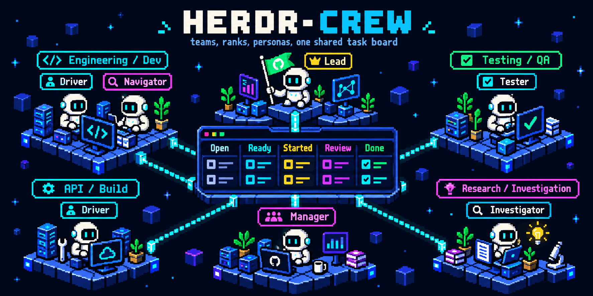

# herdr-crew



herdr-crew starts a small team of configurable agents inside Herdr, a terminal program that splits one window into tabs and panes. One command, `/herdr-crew lead "<what you want>"`, starts a Lead agent that talks to you, a Manager agent that starts worker teams, and a task board. Development teams use separate Git worktrees. The investigation team reads the current repo without a new branch or worktree. Every agent shares one board, which is tsk, a small command-line task list.

**Experimental:** automated launcher checks pass, but full live development acceptance is pending. See [known limitations](#known-limitations) and [verification status](docs/STATE.md).

## How it works

A crew lives in one Herdr tab. The Lead and the Manager sit at the top, and the board sits under the Lead:

```
+------------------------+------------------------+
|  Lead                  |  Manager               |
|  talks to you          |  starts worker teams   |
+------------------------+                        |
|  Board (tsk)           |                        |
+------------------------+------------------------+
```

The Lead splits your job into tasks, such as T1 and T2. The Manager starts a team for each task in its own tab. A development team tab such as "T7 pair" uses a worktree at `~/.herdr/worktrees/<slug>/T7-pair`. An "investigate" tab uses the current repo. The `<slug>` is a short id for your repo:

```
+------------------------+------------------------+
|  driver (member)       |  navigator (inspector) |
|  writes code and tests |  reviews, runs tests   |
+------------------------+------------------------+
   worktree: ~/.herdr/worktrees/<slug>/T7-pair
```

Each task moves through these states on the board:

```
open -> ready -> started -> review -> done
```

The Lead marks tasks `ready`. Agents mark them `started` and `review`. For development, the Manager marks `done` after code-review approval; you still merge the branch. For investigation, the Manager checks answer coverage and marks `done` without a merge branch. A task is `blocked` when information prevents progress, or when development review is not approved after three rounds. Standalone jobs without a Manager leave results at `review` for manual acceptance.

Agents talk with `herdr-crew say <agent> "<message>"` and report with `herdr-crew mark <T#> <status> "<note>"`. The mark command updates the board, adds the note as a step, and sets the pane title.

## Requirements

- **Herdr**, with the `herdr` command on your PATH.
- **Claude Code** (the default), or **OpenCode 2** for roles assigned to it. Mixed-agent teams need both selected CLIs on PATH. Authenticate each CLI separately before launching a crew.
- **tsk**, the task board. Install it with `brew install smarzban/tap/tsk`, then run these once:
  - `tsk setup claude` registers tsk with Claude Code.
  - `tsk setup herdr` registers tsk with Herdr.
  - `herdr server reload-config` makes a running Herdr pick up the change.
- **jq**, **git**, **rg** (ripgrep), and **shasum**. The launcher uses rg for visible-paste detection and shasum for the repo slug.
- **npm**, only if you want `install-skills` to install the AXI tools.
- Bash and a `readlink` command supporting `-f` (the launcher resolves symlinks with it).

## Installation

Clone or download this repository, then run the following from its root. Keep the checkout in a permanent location: these links point to it.

```bash
project_dir="$(pwd -P)"
mkdir -p "$HOME/.local/bin" "$HOME/.claude/skills" "$HOME/.claude/agents"
ln -s "$project_dir/bin/crew" "$HOME/.local/bin/herdr-crew"
ln -s "$project_dir" "$HOME/.claude/skills/herdr-crew"
for rank in "$project_dir"/ranks/crew-*.md; do
  ln -s "$rank" "$HOME/.claude/agents/$(basename "$rank")"
done
```

If a link already exists, inspect it before replacing it; the commands above do not overwrite existing files. Make sure `~/.local/bin` is on your PATH. Restart Claude Code after linking the skill and ranks.

Then install the Claude skills the personas need. Check first:

```bash
~/.claude/skills/herdr-crew/bin/install-skills --check
```

`--check` changes nothing. It prints `ok` or `MISSING` for each skill and exits with status 1 if anything is missing. To install what is missing, run the script with no flags:

```bash
~/.claude/skills/herdr-crew/bin/install-skills
```

For each missing item it shows the command and asks `[y/N]`. Nothing installs unless you answer `y`. Add `-y` to accept every prompt, but only if you trust the sources in `skills.sources`.

**Manual prerequisite:** the Manager requires the `caveman:caveman` plugin skill. Install that plugin separately before launching a crew. `install-skills --check` does not currently detect this requirement, so a passing check alone does not mean all required skills are installed. Several domain skills also need manual installation because their sources are listed as `UNKNOWN`; see [known limitations](#known-limitations).

## How to use

### Configure agents for this project

Run the setup in your project directory:

```bash
herdr-crew configure
```

It lists installed supported CLIs and asks for a role and agent. For OpenCode it reads the project's available model catalog: choose a number, enter a full model ID, or type a search term, then choose one of that model's effort variants. Blank or `0` keeps the runtime default; models without variants skip the effort question. Claude keeps its model/effort prompts. Choose `all` to set the four rank defaults, then add individual job overrides. Existing job overrides remain in place. The wizard saves once at the end; EOF cancels its pending changes. For scripts or direct changes:

```bash
herdr-crew configure all claude
herdr-crew configure driver opencode --model provider/model --effort high
herdr-crew configure code-reviewer claude --model inherit --effort high
herdr-crew configure --show
```

Replace `provider/model` with a model available in your authenticated OpenCode installation. Supported agents are `claude` and `opencode` (version 2). Other Herdr agent kinds, including Codex and Gemini, need permission/lifecycle adapters before they can be selected. Unsupported selections fail explicitly.

Settings live in `.herdr-crew.json` in the primary project checkout. Each project's linked worker worktrees read that same file, including uncommitted configuration edits. For a manually entered linked checkout with separate Git metadata that does not identify its primary working directory, set `CREW_REPO` to the primary project directory; crew-created workers already receive it. Ambiguous checkout discovery fails rather than writing into Git metadata. You can commit it to share assignments, or keep it local. It contains agent/model settings, never credentials:

```json
{
  "version": 1,
  "roles": {
    "member": { "agent": "claude", "model": "haiku" },
    "driver": { "agent": "opencode", "model": "provider/model" }
  }
}
```

Valid keys are `lead`, `manager`, `member`, `inspector`, and the job personas below. Job settings override their rank; project settings override the bundled defaults. Changing agent clears inherited model/effort values from the previous runtime. With the same agent, omitted model/effort retains the inherited setting; changing an OpenCode model clears its inherited variant because variants belong to that model; `inherit` explicitly uses that agent's own default. For OpenCode, `--effort` selects a catalog variant of the explicit `--model`; supported names vary by model, so an unsupported choice fails without saving. Keep the variant in `effort`, rather than embedding `#variant` in the model field. The adapter writes the native `#variant` only on the crew agent selection, because OpenCode's root model default drops variants. The wizard and explicit OpenCode efforts query `opencode api --standalone model.list` in the primary checkout; this uses a private metadata server, creates no agent session and submits no model prompt. Catalog errors cancel setup without writing pending changes. Deleting a role entry restores inheritance. Without a config file, the existing Claude defaults apply. There are no user-wide overrides.

Selection changes apply to new launches. Restart keeps the saved agent/model/effort in the same pane; it does not migrate a running session to another agent. Configure and `--show` need no Herdr server or tsk. Launch preflight checks the selected executables and OpenCode major version before creating tasks, worktrees or panes.

OpenCode receives a per-pane native role policy and runs with `--standalone`. Read-only ranks retain their command allowlists; members have edit/shell access and explicit Git push/merge denies. Subagents are disabled to prevent a broader helper policy bypassing the rank. Member access outside the working directory may ask for approval. Managed runtime configuration and trusted plugins remain part of the runtime's trust boundary.

Claude keeps its hooks, Skill/Explore and Monitor workflow. OpenCode uses portable skills and bounded shell waits; automatic crew context warnings and asynchronous Monitor wakeups are unavailable. It reports these limits and hands off before compaction. Claude plugin skills are not automatically portable. The current `install-skills` installer still targets Claude; install portable skills for OpenCode through its normal skill installation paths. The generated brief identifies the verified crew installation path. Runtime policy enforcement and full cross-agent orchestration still need live acceptance; automated fixtures are not that evidence.

### Start a crew

Open a Herdr pane, change into your repo, and invoke the herdr-crew skill from your configured agent (or run `herdr-crew launch lead "<instructions>"` in the shell). For the default Claude installation, type:

```
/herdr-crew lead "Add a CSV export button to the reports page"
```

Then this happens:

1. The launcher finds your repo with `git` and uses the Herdr workspace you are in.
2. It opens a tab named `crew <slug>` with the Lead, the Manager, and the board. The tab opens in the background, so switch to it yourself.
3. The Lead reads your request, may ask you a question in its pane, creates tasks on the board, and marks them `ready`.
4. The Lead sends the task numbers to the Manager, which opens a tab for each task.
5. The command prints a line or two, such as the tab name. The rest happens in the crew tab.

Watch progress in four places: the board pane, the pane titles (such as `T7 <agent>: started`), the team tabs, and `herdr-crew status`.

### Ask for a visual plan before implementation

Tell the Lead what you want planned:

```text
/herdr-crew lead "Plan the checkout retry change. Show the flow and failure cases before implementing it."
```

The Lead sends a planning task to the Manager, which starts one `planner` in a separate worktree. The planner writes a Markdown plan with Mermaid source and a local visual review page. You see the goal, before/after, a small component/activity overview, optional sequence/state detail, and tasks with exact files, regressions and verification commands.

The planner checks target source against its retained snapshot before drafting or revising. Relevant dirty changes or source drift block progress until you choose the source explicitly; nothing is reset or merged automatically. The Lead rechecks source before implementation dispatch.

The Manager's `plan ready:` completion means the draft is available. The Lead presents it and asks you to approve its commit/hash and scope before implementation starts. Test/simulation feedback, annotations and completed drafting tasks do not authorize implementation. Approval stays in tsk; changing the canonical plan materially requires a new version and approval. If the browser is unavailable, review the Markdown instead.

You can request revisions on the same planning task. The retained planning branch/worktree preserves versions and source evidence across sessions; the handoff records task, paths, commit/hash, approval, gaps and next action. The planning branch does not need to be merged just to read the approved plan. A small explicitly authorized fix or a source-only question keeps its existing route when planning is unnecessary.

For an optional standalone draft, use `/herdr-crew planner "<what to plan>"` or `herdr-crew team plan T<n>` for an existing task. A standalone planner stays at `review` for manual acceptance. It does not create a Manager or authorize implementation. The target repository needs a commit for a planning worktree; an unborn repository is reported as a prerequisite instead of receiving an unsolicited initial commit.

Read the [plan contract](docs/planning/visual-plan-contract.md), [template](docs/planning/visual-plan-template.md), [worked example](docs/planning/examples/handoff-plan.md), and [acceptance checklist](docs/planning/acceptance.md). The documentation-only worker scope is enforced by instructions and review, not a new filesystem sandbox. Local `.lavish/` output is kept out of commits even if the target does not ignore it. The existing restart handoff-file race remains unresolved; this feature does not establish live restart continuity.

### Talk to a running crew

Run the same command again with new text:

```
/herdr-crew lead "Also add a test for the empty report case"
```

The launcher sees that a Lead is already running. It sends your text to that Lead and does not start a second crew.

### Start one team directly

For a small job you can skip the Lead. A spec has the form `<rank>@<persona>[+<persona>]`, or it can be a job persona alone. The rank sets what the agent may do, as described in the Reference section.

- `driver` starts a pair team for a new task. The rank comes from the persona, so this means `member@driver`.
- `member@driver+nestjs-expert` does the same, and the driver also gets the NestJS persona.
- `investigator` starts a read-only investigation for a new task.
- Reviews use `herdr-crew team review T<n> --persona code-reviewer=security-paranoid` on an existing pair task. A fresh code-reviewer launch is refused.

```
/herdr-crew driver "Fix the login redirect loop"
```

For an existing task, `herdr-crew team pair T<n>` reuses its branch and retained worktree, preserving uncommitted files. A branch checked out elsewhere or an unrelated directory still causes an error.

The first line of your text becomes the task title, and the full text becomes the notes. The task starts as `ready`, and the selected team opens using its configured worktree rule.

The `review` team checks out the `crew/T#-pair` branch, so it needs a task that already has that branch. A spec such as `inspector@code-reviewer` is refused before anything starts: no task is created and nothing is started. To review a task with a pair branch, ask the Lead, or run `herdr-crew team review <T#>` inside a crew pane.

### Pick personas for a team

A `--persona` flag swaps the persona in a team job. The Manager can do this when the Lead asks. You can also run it yourself inside a crew pane:

```bash
herdr-crew team pair T12 --persona driver=nestjs-expert --persona navigator=security-paranoid
```

The part before `=` is the job, and the part after `=` is the domain persona. Stack several with `+`.

`team` finds its workspace the same way `launch` does. In a crew pane it uses that pane's workspace. In any other Herdr pane it uses the current workspace. Outside Herdr it uses the `crew-<slug>` workspace, as described in "Running from outside Herdr".

### Check status

```bash
herdr-crew status
```

It prints one line per open task in the form `T<number><TAB><status><TAB><title>`, then one line per live agent in the form `<agent name><TAB><state>`. States are `idle`, `working`, `blocked`, `done`, and `unknown`. Add `--json` to print the raw task list instead, for scripts.

### Close a team

```bash
herdr-crew close T12
herdr-crew close T12 review
```

Without a team, this closes the tabs whose names start with `T12 `. With a team, it closes only that tab, such as `T12 review`. It keeps the worktrees and prints the command to remove each one, such as `git -C <repo> worktree remove <path>`. It never runs that command itself.

### Watch the board

The Lead watches the board on its own. It runs `herdr-crew watch` in the Monitor tool, which polls every 20 seconds and prints one line for each change:

```
T7 ready -> review: fix the login bug
my-app-3f9c-t7-driver blocked
handoff my-app-3f9c-t7-driver /home/you/.herdr/crew/my-app-3f9c/handoff-my-app-3f9c-t7-driver.md
```

Unchanged state prints nothing. Set `CREW_WATCH_SECS` to change the interval. Press Ctrl+C to stop it. The Manager also uses Monitor for worker waits, so it can handle messages while workers run.

### Context budget and handoffs

Claude agents have a warning budget of 135000 tokens, set with `CREW_CTX_LIMIT`. A hook, `bin/ctx-guard`, warns once per session when it reaches the budget. OpenCode agents must monitor context themselves; they do not receive this hook. The agent then writes a handoff and stops:

```bash
herdr-crew handoff "half done, tests pass" <<'EOF'
Goal, what is done, what is in progress, next steps, files, task number.
EOF
```

The handoff is saved to `~/.herdr/crew/<slug>/handoff-<agent>.md`, and the task gets a `[handoff]` step. The agent that started it, the manager for a worker, is told. It restarts the agent with `herdr-crew restart <agent>`, or restarts a whole team with `herdr-crew restart T12`. A restart tolerates an agent that has already exited, waits for the pane to reach its shell, then starts the agent in the same pane with its saved brief and a line that points to the handoff. A stale registry name is cleared only after its old pane reaches the shell.

### Merge the work

Merging is always your decision. Crew instructions require approval before a push, merge, or worktree removal. Member sessions also receive explicit Bash denies for `git push` and `git merge`. A completed development task has passed code review and can have a branch such as `crew/T7-pair` for you to merge. A completed investigation contains answers and has no merge branch. The Lead has no direct Git command access, but its gh-axi allowlist includes merge operations; its approval rule remains necessary.

### Running from outside Herdr

- Inside Herdr, the crew uses your current workspace.
- Outside Herdr with the server running, the crew uses a workspace named `crew-<slug>`. The script creates it on the first run and reuses it later. Run `herdr` to attach and see it.
- Outside Herdr with no server running, the command stops and tells you to start Herdr with `herdr` and run it again there.

### Typical session

1. In your repo, run `/herdr-crew lead "Add a CSV export button to the reports page"`.
2. Switch to the `crew <slug>` tab. The Lead proposes tasks and may ask you a question.
3. The Manager opens a tab per task, such as `T1 pair`. The driver writes a failing test first, then the code, and commits to `crew/T1-pair`. The navigator reviews as the work goes.
4. When the driver marks the task `review`, the Manager runs the `review` team. If the reviewer asks for changes, the driver fixes them and the review runs again, up to three rounds. No action is needed from you.
5. To run tests, ask the Lead. The Manager runs the `test` team on the same task.
6. When the Lead reports the task `done`, read the branch, run the tests yourself, and merge when satisfied. The Manager closes the team tabs. Run the printed removal command when you no longer need the worktree.

## Ask questions about the project

Send ordinary questions to the Lead: “Does session expiry exist?” or “How does login reach storage?” You can ask one at a time or provide a numbered batch:

```text
1. Does session expiry exist?
2. Is password reset connected to the login screen?
3. How does a login request create a session?
```

The Lead delegates quick lookups to a read-only Explore sub-agent using Haiku 5.5 (`claude-haiku-5-5`) with medium effort. The tested Agent schema accepts the `haiku` alias rather than a full model ID; the Lead reports when exact pinning or model resolution cannot be verified. Claude Code 2.1.292 or later supports the per-invocation effort setting; Haiku 5.5 requires 2.1.293 or later. The Lead reports unsupported or overridden settings instead of silently substituting them.

For deeper investigation, the Manager starts the `investigate` team. Its inspector reads the current repo without creating a branch or worktree. Each question gets a direct answer, a short explanation, `file:line` evidence, the inspected source version, and any verification gaps. The Manager checks answer coverage. The Lead then reports the results.

Source inspection explains what is implemented and connected. It does not establish what is deployed or working in production. Absence claims include the searched scope. An unused definition or disabled feature is reported as partial or unreachable, rather than fully working.

Ask an active follow-up normally, such as “What happens when that session expires?” The Lead adds a numbered question to the task. If the investigation has ended, a follow-up that needs fresh exploration uses a new linked task and rechecks the source. Earlier answers remain in tsk. A discovered bug does not automatically start a fix.

For an optional standalone investigation:

```bash
herdr-crew launch investigator - <<'EOF'
1. Does session expiry exist?
2. How does login reach storage?
EOF
```

Run this inside Herdr. Read the resulting answers with `tsk list T<n> --json`, using the task number printed by the launcher. Without a running Manager, the task stays at `review` for manual acceptance. It does not claim `done` automatically. You can also ask the Manager to run `herdr-crew team investigate T<n> --persona investigator=nestjs-expert` for a backend investigation.

A separate investigator costs another agent session and coordination. Quick facts stay with the existing helper path. Investigation closes after its answers are accepted; it is not a permanently running project index.

## Reference

### Ranks

A rank sets what an agent may do. The rank files live in `ranks/`, and symlinks in `~/.claude/agents/` let Claude Code load them.

| Rank | What it can do | Model | Effort | Communication style | AXI tools |
|---|---|---|---|---|---|
| `lead` | Talks to you, owns the board, asks before any merge. Does not edit code. | opus | high | Simplified Technical English (short, plain sentences) | gh-axi, lavish-axi |
| `manager` | Starts teams, watches workers, reports to the Lead. Does not edit code or merge. | haiku | max | Very terse, with filler words removed | quota-axi |
| `member` | Reads and writes files in its own worktree and commits on its branch. Never pushes or merges. | haiku | high | Default | none |
| `inspector` | Read-only. Reviews, navigates, triages bugs, runs tests. | haiku | xhigh | Default | none (see AXI tools) |

These are bundled Claude defaults. Project agent assignments override them. Effort sets how much the model thinks before it answers. A job persona can set its own Claude effort, which overrides the bundled rank effort; explicit project settings take precedence.

### Personas

Job personas have a `rank:` line and fill a team slot. Domain personas have no `rank:` line and can be added to any job. If none is given, `pragmatic-senior` is used.

| Persona | Kind | Rank | Skills | AXI tools | Effort | Purpose |
|---|---|---|---|---|---|---|
| `driver` | job | member | tdd, verification-before-completion, karpathy-guidelines, ponytail, systematic-debugging | gh-axi | high | Writes code test-first in its worktree |
| `tester` | job | member | tdd, verification-before-completion | chrome-devtools-axi | none | Writes and runs test files only |
| `qa-bug-reproducer` | job | member | diagnosing-bugs | chrome-devtools-axi, gh-axi | none | Tries to reproduce a bug. May add one failing test file only. |
| `navigator` | job | inspector | ponytail:ponytail-review, verification-before-completion | none | none | Watches the driver live, runs tests, gives a verdict |
| `code-reviewer` | job | inspector | code-review, ponytail-review | gh-axi | max | Reviews a branch against the repo's standards and the task |
| `qa-bug-triager` | job | inspector | qa-bug-validator | gh-axi | none | Decides if a reported bug is real, by reading the source |
| `investigator` | job | inspector | none | none | inherited | Answers project questions and traces flows with source evidence; writes answers to tsk |
| `planner` | job | member | none | lavish-axi | inherited | Writes source-grounded visual plans only; reports draft version for user approval |
| `pragmatic-senior` | domain (default) | any | karpathy-guidelines, ponytail | none | none | Makes the smallest change that solves the task |
| `nestjs-expert` | domain | any | nestjs-best-practices, context7-mcp, supabase, supabase-postgres-best-practices | none | none | NestJS and Node backend work. Postgres or Supabase work loads the two Supabase skills first. |
| `react-expert` | domain | any | react-production-engineering, react-component-engineering, react-quality-engineering, context7-mcp | chrome-devtools-axi | none | React and TypeScript work. Next.js repos also load vercel-react-best-practices. |
| `ui-expert` | domain | any | impeccable, react-component-engineering, react-production-engineering, react-quality-engineering | chrome-devtools-axi | none | Clean UI design and development; desktop/mobile browser evidence. Marketing, motion, and UI review skills load when relevant. |
| `security-paranoid` | domain | any | none | none | none | Treats every input as hostile, with an exploit scenario for each issue |

### Teams

A team is a group of jobs plus a worktree rule. The files live in `teams/`.

| Team | Members | Worktree and branch |
|---|---|---|
| `pair` | driver (member), navigator (inspector) | New branch `crew/T#-pair` in its own worktree |
| `review` | code-reviewer (inspector) | Detached checkout of `crew/T#-pair`. Run `pair` first. |
| `test` | tester (member) | New branch `crew/T#-test`, from `crew/T#-pair` if it exists, else from HEAD |
| `bug-validate` | qa-bug-triager (inspector), qa-bug-reproducer (member) | New branch `crew/T#-bug-validate` in its own worktree |
| `investigate` | investigator (inspector) | Current repo, no new branch or worktree |
| `plan` | planner (member) | New or retained `crew/T#-plan`; documentation artifacts only |

Worktrees live at `~/.herdr/worktrees/<slug>/T<n>-<team>`. The `<slug>` is the first six characters of the repo folder name, plus four hex characters from a hash of the repo path, so two repos with the same name stay apart. Agent names look like `<slug>-t<n>-<job>`, such as `my-app-3f9c-t7-driver`. The Lead is `<slug>-lead` and the Manager is `<slug>-manager`.

### Commands

Every command explains itself. `herdr-crew help` lists them, `herdr-crew help <command>` and `herdr-crew <command> --help` show one command's arguments, options and examples, and `herdr-crew --version` prints the version. All five help forms work without tsk, herdr or jq on PATH. Git is still required, because repo and slug resolution runs first. Global options go before the command: `--dry-run` (the same as `CREW_DRY_RUN=1`), `--help`, `--version`.

| Command | What it does |
|---|---|
| `herdr-crew launch <spec> -` | Starts a crew (`lead`), or a new task with its team (a job spec). Instructions come on stdin, or as words after the spec. |
| `herdr-crew team <team> <T#> [--persona <job>=<domain>[+<domain>]]... ["instructions"]` | Starts a team for an existing task. Optional instructions override the task notes for the brief. Workspace selection also supports other Herdr panes or a running external server. |
| `herdr-crew say <agent> "<message>"` | Sends to an idle/done agent, or waits up to 20 seconds. Task workers can receive queued task steps. A busy Lead/Manager has no task queue; output can say `message NOT delivered` even with exit 0. |
| `herdr-crew mark <T#> <status> "<note>"` | Sets the task status, adds the note as a step, and sets the pane title. |
| `herdr-crew status [--json]` | Prints one line per open task (T number, status, title) and one per crew agent (name, state), tab separated. `--json` prints the raw task list for scripts. |
| `herdr-crew close <T#> [<team>]` | Closes all matching task tabs, or one team's tab. Keeps worktrees and prints removal commands for existing paths. |
| `herdr-crew watch` | Prints one line per board change: task status, a crew agent that became `blocked` or `done` or disappeared, and each new handoff. The Lead runs it with Monitor. Press Ctrl+C to stop. |
| `herdr-crew handoff "<status>"` | Saves the handoff body from stdin, adds a step to the task, and tells the agent that restarts this one. Run by the agent itself. |
| `herdr-crew restart <agent or T#>` | Sends `/exit`, waits for the pane to reach its shell, and starts the agent again from its saved brief. A `T#` restarts every agent of that task. |
| `herdr-crew completion <bash\|zsh>` | Prints a shell completion script on stdout. |

### Output style

Result lines start with `crew:`, progress lines with `->`, and warnings with `warning:`. Colour is used only when stdout is a terminal, and `NO_COLOR` turns it off. Errors go to stderr, name the problem, and list the valid values or the next command to run. Long operations print a progress line for each agent they start, because an agent start can take minutes.

### Environment variables

The launcher sets these in each pane it creates:

| Variable | Meaning |
|---|---|
| `CREW_SLUG` | The crew id, such as `my-app-3f9c` |
| `CREW_REPO` | Path to the repo |
| `CREW_TASK` | Task number in team panes, such as `T7`. Empty in Lead and Manager panes. |
| `CREW_AGENT` | This agent's name. `say` and `mark` use it as the sender. Defaults to `user`. |
| `CREW_MANAGER` | The Manager's agent name |
| `CREW_WS` | The Herdr workspace that holds the crew |

Claude agents receive a SessionStart hook that restores these variables for Bash commands on startup and resume. Agents started before this hook was added need `herdr-crew restart <agent>` to receive it.

You can set `CREW_REPO` and `CREW_SLUG` yourself to override the repo path and crew id. Set `CREW_DRY_RUN=1` to print mutating Herdr, tsk, and Git calls instead of executing them. Discovery reads and dependency checks still run; this is a mutation preview, not an offline simulation.

For all environment controls, command options, hook behavior, and completion flows, see [the feature reference](docs/features.md).

### AXI tools

AXI (Agent eXperience Interface) is a set of command-line tools built for agents. Their output is short and consistent, so an agent spends fewer tokens on it than on raw CLI output. See https://axi.md.

Each persona or rank declares the AXI tools it uses in an `axi:` line in its frontmatter. The tables above show the mapping:

- The lead uses `gh-axi` and `lavish-axi`. The manager uses `quota-axi`. The planner uses `lavish-axi` for the review projection.
- The driver and the code reviewers use `gh-axi`. The driver never pushes, merges, or creates PRs with it.
- The tester and the react-expert use `chrome-devtools-axi`.

Inspectors are read-only. Their tool list allows only read-only `gh-axi` and `chrome-devtools-axi` commands. The inspector rank has no `axi:` line, so its brief does not list them.

The launcher adds the tools to each agent's brief. If a tool is not on PATH, the launcher prints a warning and still launches the agent. `install-skills --check` reports each AXI tool. Without `--check`, it offers to run `npm i -g <package>` for each missing tool, and it does nothing unless you answer yes.

The lead's tool list allows `gh-axi *`, which includes `pr merge`. Only the lead's rule to ask before any merge stops it. The `tasks-axi` tool is not used, because tsk is the task board.

## Customizing

### Add a persona

Create a Markdown file in `personas/` with a frontmatter block, which is the text between two `---` lines:

```markdown
---
rank: member
skills: tdd, verification-before-completion
effort: high
---
Job instructions go here, in plain sentences.
```

- A job persona needs `rank:`, set to `member` or `inspector`. A domain persona leaves it out.
- `skills:` and `effort:` are optional. Every listed skill must be installed, so run `install-skills --check`.
- `axi:` is optional. It lists AXI tools by name, such as `gh-axi`. Each one needs an `<tool> axi npm:<pkg>` line in `skills.sources`, so install-skills can install it.
- A job only works in a team that lists it, so a new job also needs a team.

### Add a team

Create a `.conf` file in `teams/`. The file name is the team name:

```
# worktree: new | from-pair | pair-branch | none
members=member@tester inspector@navigator
worktree=new
```

- `members` lists `<rank>@<job>` entries. The first gets the tab's first pane, and the rest are split off it.
- `worktree` is one of `new` (branch from HEAD), `from-pair` (branch from `crew/T#-pair` when it exists), `pair-branch` (detached checkout of `crew/T#-pair`, fails if missing), or `none` (current repo, used by the Lead layout and investigation).
- The Manager's rules name the teams, so add the new team there too. `SKILL.md` lists them as well.

### Change a bundled default model or effort

Prefer `herdr-crew configure` for project-specific changes. Editing bundled files changes the installation defaults for projects without overrides.

- Edit `model:` (`opus`, `haiku`, or `inherit`) or `effort:` in the rank file. `inherit` passes no `--model` flag, so Claude Code's default applies.
- Edit a persona's `effort:` to change one job. It overrides the rank.

### Use OpenCode for a rank

Use `herdr-crew configure <rank-or-job> opencode --model provider/model`. OpenCode 2 is required. Legacy rank frontmatter (`kind: opencode`, `opencode_model:`) remains a fallback when no project override applies, with the same version/permission checks. Existing OpenCode sessions without saved native-policy metadata must be relaunched rather than restarted.

## Testing

From the skill directory, run:

```bash
/bin/bash test/dry-run.sh
/bin/bash test/worktrees.sh
/bin/bash test/agent-config.sh
```

The test puts fake `herdr`, `tsk`, and `git` commands first on your PATH, and checks the calls they record. No real agents start and no real tasks are made. Each check prints `PASS` or `FAIL`, and the run ends with `ALL PASS` or a failure count.

`test/worktrees.sh` uses real Git with fake Herdr/tsk and a disposable HOME. It checks branch attachment, retained edits, reuse, and ownership refusals. Neither suite establishes live agent behavior. [STATE.md](docs/STATE.md) separates automated checks from live acceptance and remaining gaps.

## Known limitations

- Visual planning has automated launch/instruction checks and a browser-checked example. Live Lead/planner approval, revision, offline fallback and restart acceptance remain pending; see [the acceptance checklist](docs/planning/acceptance.md).

- In a live test, the Haiku driver once said it had no shell, and the Manager once used an old, archived task number. Both are under investigation.
- The launcher answers Claude's "trust this folder" prompt only for agents it starts in a new pane. Any other trust prompt is yours to answer.
- Worktrees are never removed automatically. Run the removal command that `close` prints when you are done.
- A busy Lead/Manager message can be undelivered with exit 0. Read the delivery output and preserve important questions in tsk.
- A startup warning does not prove a prompt was lost. Inspect the pane and recorded messages before sending anything again.
- `tsk steps add` rejects newlines and control characters. Record one-line answers or notes; handoff files can contain multiline text.
- Test concurrency limiting is [research only](docs/research/test-concurrency.md). There is no built `test` or `tests` launcher subcommand or test-rewriting PreToolUse hook.
- Some skills in `skills.sources` are `UNKNOWN`: `qa-bug-validator`, `react-production-engineering`, `react-component-engineering`, `react-quality-engineering`, `impeccable`, and `context7-mcp`. `install-skills` cannot fetch them, so install them by hand if they go missing.

## File layout

```
herdr-crew/
├── README.md            this file
├── SKILL.md             the /herdr-crew command and its instructions
├── bin/
│   ├── crew             the launcher (installed as herdr-crew)
│   ├── ctx-guard        context budget hook (warns at 135K tokens, once per session)
│   └── install-skills   checks for and installs persona skills
├── ranks/               four ranks: lead, manager, member, inspector
├── personas/            job personas and domain personas
├── teams/               team layouts (.conf files)
├── skills.sources       where each skill comes from, or UNKNOWN
├── docs/                current reference, verification state, history, ADRs and research
└── test/
    ├── dry-run.sh       hermetic launcher checks
    └── worktrees.sh     real-Git regression checks
```

## Docs

The `docs/` folder records the progress log, the current state, and the architecture decisions (ADRs). Start with [docs/README.md](docs/README.md), then [docs/STATE.md](docs/STATE.md).

## License

[MIT](LICENSE).
