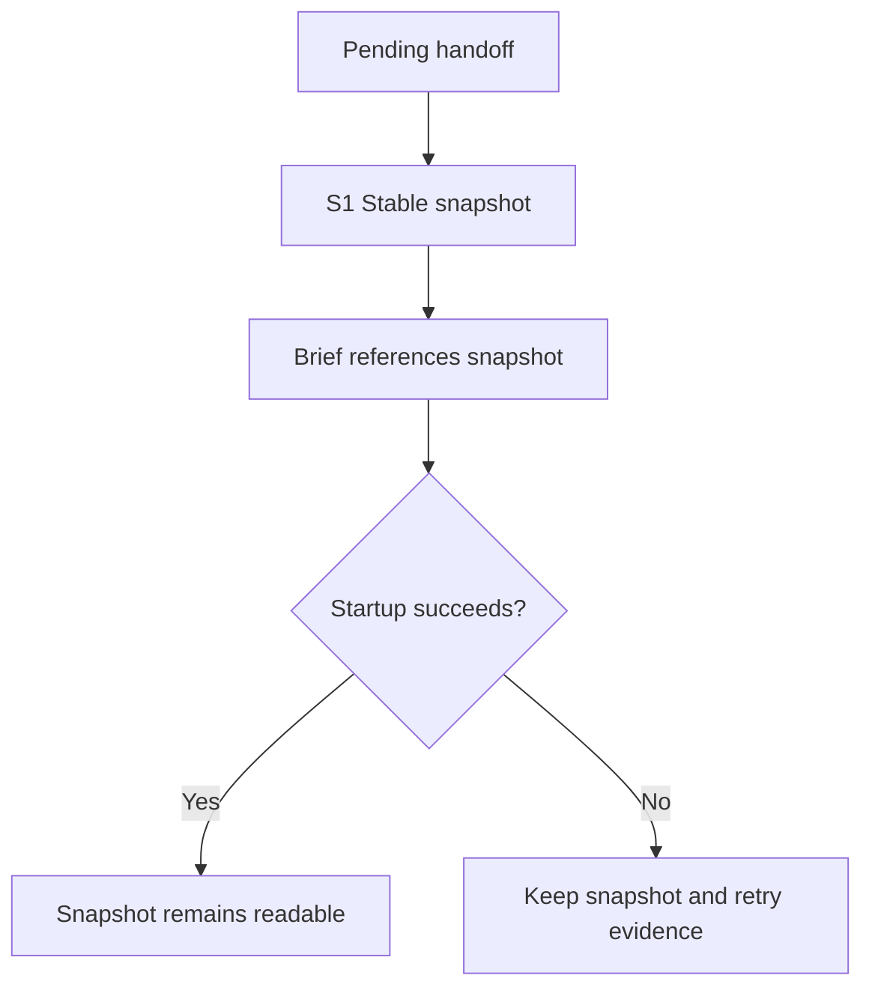
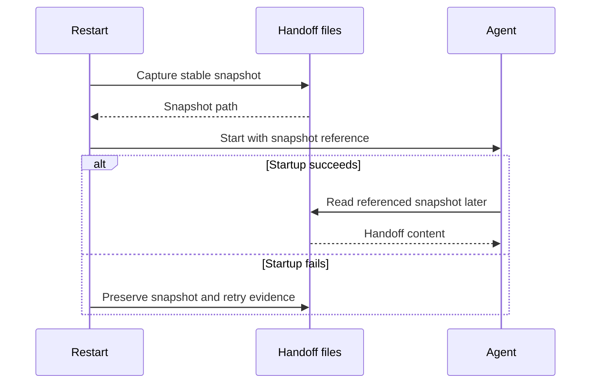

# Keep restart handoffs readable — illustrative plan

Documentation example only. The maintenance fix is separately pending approval; this example does not implement or authorize it.

## Goal

A resumed agent can read the exact handoff referenced in its brief after restart returns.

## Before → after

- Trigger: restart an agent with a saved handoff.
- Before: the brief references the canonical file, then restart renames it before an asynchronous reader may open it.
- After (proposed): a stable snapshot path remains readable, including after a failed startup or a rapid retry.

## Scope and evidence

Inspected source baseline: herdr-crew main, commit 879f9bb. The example references [restart_one](../../../bin/crew) at lines 534–538 and [restart tests](../../../test/dry-run.sh) at lines 296–303 in that baseline. This is source evidence, not a live reproduction.

Included: handoff snapshot lifecycle and its regression. Excluded: worktree ownership, stale test branches, status polling, dependencies, model settings and publication. Snapshot naming/failure cleanup require a concrete choice during the separately reviewed fix; do not infer a live acceptance result.

## S1 overview: proposed invariant

S1 creates the stable reference before dispatch. Both successful and failed startup retain readable evidence.

## S1 ordering

This ordering is proposed. It does not claim the current restart function implements it.

## S1: Preserve the referenced snapshot

- Files/functions: bin/crew restart_one; test/dry-run.sh restart fixture.
- Contract: existing restart command; referenced handoff stays readable with identical content. Failed startup preserves retry evidence and a newer handoff.
- Depends on: none.
- Failing regression: restart_handoff_path_survives extracts the actual prompt path and reads it after restart, asserting the saved body. Add failure/rapid-retry coverage before implementation.
- Red command/result: /bin/bash test/dry-run.sh; expected nonzero because the referenced path disappears in the current implementation.
- Minimal change: snapshot before submission and reference that stable path; select collision-safe naming and preserve newer pending evidence.
- Verification: /bin/bash test/dry-run.sh; expected exit 0/ALL PASS. Syntax check each changed shell file separately.
- Done when: success, startup failure, rapid retries and a newer handoff preserve the intended content, and independent review approves the diff.

## Risks and review request

Asynchronous reads and overlapping handoffs make cleanup significant. Fake-agent assertions establish the file invariant; they do not establish live Claude restart acceptance. Obtain separate approval before running live agents or applying this maintenance fix. Approval must identify the committed version of the actual executable plan, not this illustrative example.
