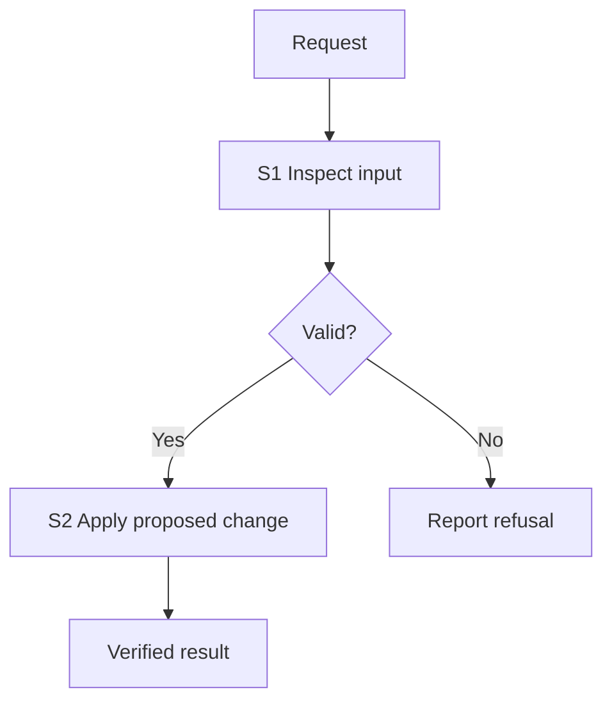

# <Change> plan

Draft identity: <slug/revision>. Approval state is recorded in tsk, outside this document's hash.

## Goal

<One sentence describing observable resulting behavior.>

## Before → after

- Trigger: <concrete user/system event>.
- Before: <observed behavior with source citation>.
- After: <proposed result and reason>.

## Scope and evidence

- Included: <bounded changes>.
- Excluded: <explicit non-goals>.
- Inspected source: <repository identity, branch, commit, relevant working changes>.
- Evidence: <relative file:line citations; source inspection versus existing runtime observations>.
- Assumptions/questions: <state unknowns and user decisions>.

## Overview

Replace this illustrative diagram with inspected/proposed components and task IDs. Keep the short explanation when diagrams cannot render.

Caption: S1 validates the request; S2 runs only on valid input. Invalid input is refused.

## Optional ordering or states

<Add a sequence for message order/failure paths or a state diagram for transitions only when it resolves a real ambiguity. Delete this section otherwise.>

## S1: <Small independently testable change>

- Files/functions: <exact paths and names>.
- Contract: <inputs, outputs, errors and preserved behavior>.
- Depends on: <S IDs or none>.
- Failing regression: <test name and exact observable assertions>.
- Red command/result: <command and expected failure>.
- Minimal change: <what changes and why>.
- Verification: <command; expected exit and output>.
- Done when: <checkable acceptance criterion>.

## S2: <Next change, if needed>

<Repeat the S1 fields; omit tasks that add no independent deliverable.>

## Risks and decisions

- <Failure modes, compatibility, missing runtime evidence and decisions needed before execution.>
- <Independent review and live acceptance requirements; what each check proves.>

## Review request

<Ask the user to approve the bounded scope. The planner reports commit/SHA256 in tsk after committing this file; it does not embed a self-referential file hash here.>
